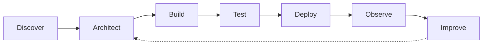

<!-- BLUE • Senior AI & Software Engineer • GitHub Profile README -->
<!-- Create a public repository named BlueCodingAI and save this as README.md -->

<div align="center">
  

  <a href="https://github.com/BlueCodingAI">
    
  </a>

  <p><strong>Crafting intelligent products. Engineering reliable systems. Turning ambitious ideas into production-ready software.</strong></p>

  <a href="https://github.com/BlueCodingAI?tab=repositories"></a>
  <a href="https://github.com/BlueCodingAI"></a>
  
</div>

<br />

## `01` / About BLUE

```typescript
const BLUE = {
  role: "Senior AI & Software Engineer | Full-Stack Developer",
  focus: ["AI Products", "LLM Systems", "Scalable SaaS", "Automation"],
  mindset: "Design thoughtfully. Build reliably. Keep improving.",
  currentlyExploring: ["AI Agents", "RAG", "LLM Infrastructure"],
  mission: "Make complex technology useful, elegant, and dependable."
};
```

I build **AI-driven applications and full-stack products**—from initial system design to APIs, user experiences, deployment, and continuous improvement. My work brings together **modern software engineering**, **intelligent automation**, and **pragmatic product architecture**.

- 🧠 **AI engineering:** LLM integration, retrieval-augmented generation, AI assistants, agents, and inference workflows.
- 🏗️ **Software architecture:** maintainable services, API design, authentication, data modeling, and scalable systems.
- 🌐 **Full-stack development:** responsive interfaces, backend engineering, SaaS platforms, and real-time features.
- ⚙️ **Automation:** Python workflows, integrations, data pipelines, and process optimization.
- ☁️ **Delivery:** cloud infrastructure, containers, CI/CD, testing, and observability.

> **Engineering principle:** Powerful software should be as thoughtful behind the scenes as it is effortless to use.

---

## `02` / Technology Universe

<div align="center">

**Languages & Core Engineering**


**Frontend & Product Experience**


**Backend & APIs**


**AI, ML & Data**


<br />


**Databases, Cloud & DevOps**


</div>

---

## `03` / What I Engineer

<table>
<tr>
<td width="50%" valign="top">

### 🤖 Intelligent AI Products

LLM applications · RAG pipelines · Agentic workflows · Conversational AI · Model APIs · Semantic search

</td>
<td width="50%" valign="top">

### 🌐 Modern Full-Stack Platforms

React & Next.js · Secure APIs · SaaS architecture · Real-time apps · Authentication · Database design

</td>
</tr>
<tr>
<td width="50%" valign="top">

### ⚡ Automation & Integrations

Python automation · External APIs · ETL · Event-driven systems · Data workflows · Operational tooling

</td>
<td width="50%" valign="top">

### ☁️ Production Engineering

Docker · Cloud deployment · CI/CD · Performance · Monitoring · Maintainable architecture

</td>
</tr>
</table>

---

## `04` / Featured Work

<!-- Featured work links point to actual public repositories. Descriptions are kept within verified scope. -->

<div align="center">
  <a href="https://github.com/BlueCodingAI/BlueChat">
    
  </a>
  <a href="https://github.com/BlueCodingAI/AdmissionBot">
    
  </a>
  <a href="https://github.com/BlueCodingAI/Qwen-Stack">
    
  </a>
  <a href="https://github.com/BlueCodingAI/Financial_Data_Analysis">
    
  </a>
</div>

| Project | Engineering highlight | Stack / focus |
|:--|:--|:--|
| [**BlueChat**](https://github.com/BlueCodingAI/BlueChat) | Real-time messaging, JWT authentication, user search, direct conversations | React, Express, Socket.IO, Prisma, PostgreSQL |
| [**AdmissionBot**](https://github.com/BlueCodingAI/AdmissionBot) | Document-grounded admissions assistant with chat and voice interaction | Next.js, TypeScript, OpenAI, RAG, TTS |
| [**Qwen-Stack**](https://github.com/BlueCodingAI/Qwen-Stack) | Repository for Qwen-focused development and infrastructure | LLM experimentation |
| [**Financial Data Analysis**](https://github.com/BlueCodingAI/Financial_Data_Analysis) | Financial-data-focused analysis repository | Data analysis |
| [**Job Application Tracking System**](https://github.com/BlueCodingAI/Job_Applicantion_Tracking_System) | Business application workflow repository | Application engineering |

<div align="center">
  <a href="https://github.com/BlueCodingAI?tab=repositories"></a>
</div>

---

## `05` / From Idea to Production



**How I think:** start with the problem, choose the smallest robust architecture, validate assumptions early, make trade-offs explicit, and prioritize security, performance, and maintainability.

---

## `06` / GitHub Pulse

<div align="center">
  
  
  <br />
  
  <br />
  
</div>

---

## `07` / Current Focus

<div align="center">


</div>

I'm particularly interested in the space where **advanced AI capabilities meet dependable real-world software**: practical agents, high-quality retrieval, scalable backend systems, and automation that saves meaningful effort.

---

<div align="center">

## `08` / Connect With BLUE

### Have something ambitious in mind?

**Let's turn it into software that works beautifully.**

<p>Available for collaborations, innovative products, and challenging engineering projects.</p>

<a href="https://github.com/BlueCodingAI"></a>
<a href="mailto:bluewonder0929@gmail.com"></a>
<a href="https://t.me/blueW09"></a>

<br />

<a href="https://discord.com/app"></a>
<a href="https://wa.me/15404436640"></a>

<br /><br />

<sub>Discord: <code>blue99_0929</code> · Email: <a href="mailto:bluewonder0929@gmail.com">bluewonder0929@gmail.com</a></sub>

<br /><br />


</div>
