<!--
  BLUE · GitHub profile README
  Repo: github.com/BlueCodingAI/BlueCodingAI  (repo name must match your username)

  Files in this repo:
    README.md                      ← this page
    assets/*.svg                   ← all animated graphics (plain SVG, hosted in this repo)
    assets/projects/*.svg          ← project cards
    .github/workflows/snake.yml    ← builds the contribution snake (run once from the Actions tab)
-->

  <a href="#01--about"><b>About</b></a> &nbsp;·&nbsp;
  <a href="#02--tech-stack"><b>Stack</b></a> &nbsp;·&nbsp;
  <a href="#03--what-i-build"><b>Services</b></a> &nbsp;·&nbsp;
  <a href="#04--featured-work"><b>Projects</b></a> &nbsp;·&nbsp;
  <a href="#05--how-i-work"><b>Process</b></a> &nbsp;·&nbsp;
  <a href="#06--github-activity"><b>Activity</b></a> &nbsp;·&nbsp;
  <a href="#08--lets-connect"><b>Contact</b></a>

## `01` / About

I build **AI-driven applications and full-stack products** — from the first system design to APIs, user experience, deployment and continuous improvement. My work brings together **modern software engineering**, **intelligent automation** and **pragmatic product architecture**.

<table>
  <tr>
    <td width="50%" valign="top">
      🧠 <b>AI engineering</b> 
      LLM integration, retrieval-augmented generation, AI assistants, agents and inference workflows.
    </td>
    <td width="50%" valign="top">
      🏗️ <b>Software architecture</b> 
      Maintainable services, API design, authentication, data modeling and scalable systems.
    </td>
  </tr>
  <tr>
    <td width="50%" valign="top">
      🌐 <b>Full-stack development</b> 
      Responsive interfaces, backend engineering, SaaS platforms and real-time features.
    </td>
    <td width="50%" valign="top">
      ⚙️ <b>Automation</b> 
      Python workflows, integrations, data pipelines and process optimization.
    </td>
  </tr>
  <tr>
    <td colspan="2" valign="top">
      ☁️ <b>Delivery</b> &nbsp;—&nbsp; Cloud infrastructure, containers, CI/CD, testing and observability.
    </td>
  </tr>
</table>

> **Engineering principle:** powerful software should be as thoughtful behind the scenes as it is effortless to use.

## `02` / Tech Stack

<table>
  <tr>
    <td align="center" width="190"><b>Languages</b></td>
    <td></td>
  </tr>
  <tr>
    <td align="center"><b>Frontend</b></td>
    <td></td>
  </tr>
  <tr>
    <td align="center"><b>Backend &amp; APIs</b></td>
    <td></td>
  </tr>
  <tr>
    <td align="center"><b>AI · ML · Data</b></td>
    <td></td>
  </tr>
  <tr>
    <td align="center"><b>Databases</b></td>
    <td></td>
  </tr>
  <tr>
    <td align="center"><b>Cloud &amp; DevOps</b></td>
    <td></td>
  </tr>
</table>

## `03` / What I Build

## `04` / Featured Work

<!-- Each card links to its public repository. Descriptions stay within what each repo shows. -->

 

## `05` / How I Work

<table>
  <tr>
    <td align="center" width="20%">🎯 <b>Problem first</b> Understand the real need before writing code</td>
    <td align="center" width="20%">🧱 <b>Smallest robust design</b> Simple architecture that can grow</td>
    <td align="center" width="20%">🧪 <b>Validate early</b> Test assumptions before they get expensive</td>
    <td align="center" width="20%">⚖️ <b>Explicit trade-offs</b> Clear reasons behind every decision</td>
    <td align="center" width="20%">🔐 <b>Built to last</b> Security, performance and maintainability</td>
  </tr>
</table>

## `06` / GitHub Activity

<!-- Generated by .github/workflows/snake.yml from the real contribution graph. -->
<picture>
  <source media="(prefers-color-scheme: dark)" srcset="https://raw.githubusercontent.com/BlueCodingAI/BlueCodingAI/output/snake-dark.svg" />
  <source media="(prefers-color-scheme: light)" srcset="https://raw.githubusercontent.com/BlueCodingAI/BlueCodingAI/output/snake-light.svg" />
  
</picture>

My real contribution graph, redrawn twice a day by a GitHub Action in this repo.

  

[**📊 Contributions & activity →**](https://github.com/BlueCodingAI?tab=overview) &nbsp; • &nbsp; [**📁 Browse repositories →**](https://github.com/BlueCodingAI?tab=repositories)

## `07` / Current Focus

I'm most interested in the space where **advanced AI capabilities meet dependable real-world software**: practical agents, high-quality retrieval, scalable backend systems and automation that saves meaningful effort.

## `08` / Let's Connect

### Have something ambitious in mind?

**Let's turn it into software that works beautifully.** 
Available for collaborations, innovative products and challenging engineering projects.

<!-- Tip: change this link to https://discord.com/users/YOUR_DISCORD_USER_ID so it opens your profile directly. -->

  

Discord: <code>blue99_0929</code> · Email: <a href="mailto:bluewonder0929@gmail.com">bluewonder0929@gmail.com</a>

  

